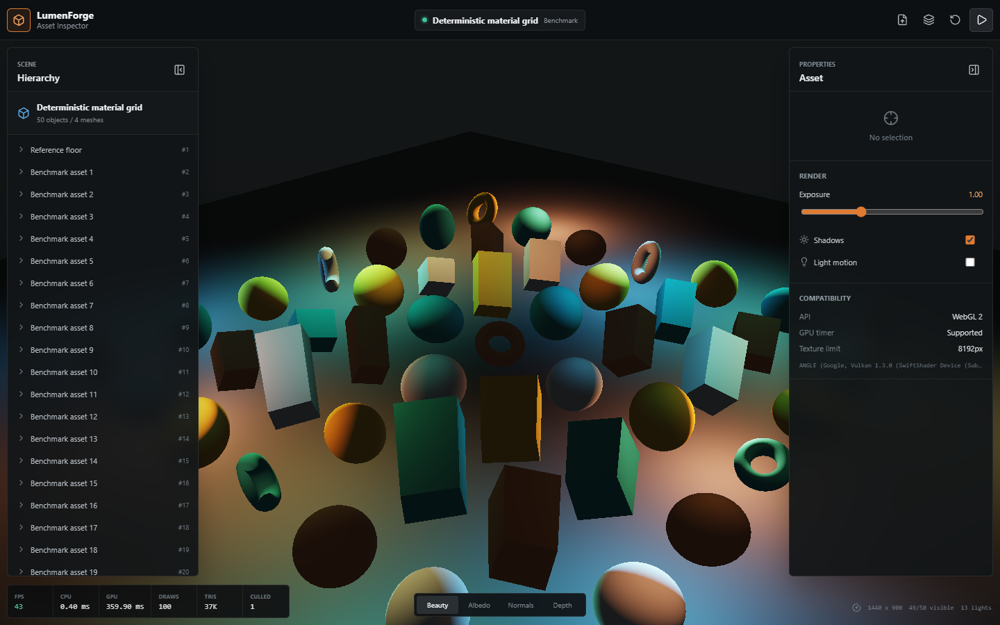

# LumenForge WebGL

LumenForge is a production-style 3D asset inspection tool built directly on
WebGL2. It loads glTF 2.0/GLB assets, renders metallic-roughness materials
through a deferred Cook-Torrance pipeline, exposes scene and material data, and
reports CPU/GPU frame diagnostics.

The default workload is a deterministic 50-object material grid with 13 lights.
It makes rendering and culling changes comparable without depending on a
network asset.

## Setup

Requirements: Node.js 20+ and a browser with WebGL2.

```powershell
npm install
npm run dev
```

Production verification:

```powershell
npx playwright install chromium   # once; browsers are not bundled with npm
npm run verify                    # lint + typecheck + vitest + build + browser
```

`npm run browser:verify` runs the Playwright suite on its own. It builds nothing
itself, so run `npm run build` first if `dist/` is stale: the suite serves the
production bundle through `vite preview` rather than the dev server, so what
ships is what gets exercised. Reviewable evidence lands in `artifacts/`.



## Why the renderer is hand-written

three.js would render this scene in a fraction of the code, and for product work
that is the right call. It is deliberately not used here, and the reason is
narrow: the point of this project is the part three.js hides. A deferred
G-buffer layout, depth-based world-position reconstruction, the GGX/Schlick term
choices, PCF filter taps, 24-bit object-id picking, and asynchronous timer-query
plumbing are the decisions a graphics engineer is hired to make. Delegating them
would leave a scene-graph configuration exercise.

So the split is drawn at what is *interesting* rather than at what is *hard*:

| Layer | Choice | Why |
| --- | --- | --- |
| Renderer, shaders, G-buffer, shadows, picking | hand-written on raw WebGL2 | the subject of the project |
| glTF parsing (runtime) | hand-written | validation and failure behaviour on untrusted input is the same kind of decision |
| Linear algebra | [`gl-matrix`](https://github.com/toji/gl-matrix) | standard algebra with a silent failure mode; see `src/engine/math.ts` |
| glTF conformance checking | `@gltf-transform/core` | an independent implementation is a better oracle than more of my own tests |
| Shell, build, tests | React 19, Vite 7, Playwright, Vitest | no reason to be exotic |

`gl-matrix` is the one place a library replaced working code, because a
transposed matrix or flipped handedness still renders — just wrong — and that is
exactly the class of bug not worth owning. `@gltf-transform/core` is a
**test-time cross-check only**; it is a devDependency and the runtime parser is
still `src/engine/gltf.ts`.

## Architecture

- **Asset pipeline:** bounded glTF/GLB parsing, accessor validation, hierarchy
  transforms, PBR factors, embedded textures, and punctual lights.
- **Renderer:** shadow depth pass, two-target G-buffer, depth reconstruction,
  Cook-Torrance GGX deferred lighting, and ACES-style tone mapping.
- **Performance:** bounding-sphere frustum culling, demand-driven GPU picking,
  asynchronous timer queries, draw/triangle counters, and capped pixel ratio.
- **Lifecycle:** versioned async uploads, resize observation, context-loss
  recovery, explicit resource disposal, and surfaced loading errors.
- **Application shell:** React scene hierarchy, material inspector, render
  controls, debug buffers, compatibility status, and drag/drop upload.

See [`docs/ARCHITECTURE.md`](docs/ARCHITECTURE.md) for pass ownership, supported
glTF features, and failure behavior.

## Controls

| Input | Action |
| --- | --- |
| Left drag | Orbit |
| Right drag or Shift + drag | Pan |
| Wheel | Dolly |
| Click | GPU object selection |
| Focus icon | Frame selected object |
| Reset icon | Restore asset camera |
| Upload icon or file drop | Load `.glb` or self-contained `.gltf` |
| Beauty / Albedo / Normals / Depth | Inspect deferred buffers |

## Rendering path

The material model follows glTF's metallic-roughness convention. Direct light
uses a GGX normal distribution, Schlick-GGX visibility, and Schlick Fresnel.
Base-color textures are uploaded as sRGB; factors and lighting remain linear
until tone mapping.

The G-buffer stores:

1. linear base color and metallic;
2. encoded world normal and perceptual roughness;
3. depth for world-position reconstruction.

A 2048 x 2048 directional map supplies 3x3 PCF shadows. The deferred pass supports 32
directional/point lights and avoids redrawing geometry per light.

## Measured evidence

Re-measured 2026-07-28 on this machine (Windows 11, Node.js 24.16.0, Chromium
151.0.7922.34 headless via Playwright 1.62.0, ANGLE SwiftShader). The
[verification record](artifacts/verification.md) and
[machine-readable browser results](artifacts/browser-verification.json) are the
raw output. Every figure below was produced by the commands in this repository;
the previous 2026-07-16 figures are superseded.

### Static and unit

| Check | Result |
| --- | --- |
| `npm run lint` (ESLint 10) | exit 0, no findings |
| `npm run typecheck` (tsc 5.9, `-b --force`) | exit 0 |
| `npx vitest run` | **36 passed / 4 files** (was 9 / 3) |
| `npx vite build` | exit 0 |
| Bundle | **264.17 kB JS (82.74 kB gzip)**, 9.59 kB CSS (2.70 kB gzip) |
| Playwright suite | **12 passed / 3 files**, 3.5 min |

The bundle grew from 211.75 kB (66.26 kB gzip) and it is worth being precise
about why, because "we upgraded and it got 25% bigger" deserves a cause rather
than a shrug. Building `main`'s source with only `react`/`react-dom` moved to 19
produces **262.70 kB** — so **97% of the +52.42 kB is React 19 itself**, not this
project's code. `gl-matrix` contributes roughly 1.5 kB after tree-shaking, since
only the `mat4`/`mat3`/`quat`/`vec3`/`vec4` functions actually called are
retained. CSS is byte-identical.

### Frame timings

SwiftShader is a **software rasterizer**, so the GPU-side numbers below are a
property of this CPU, not of a GPU. They are published only because they are
reproducible and comparable *against each other*; they are not hardware
performance claims and are excluded from the resume bullets.

Method: 6 independent runs per build, each a fresh browser and page, 3 s warm-up
(shader compilation, uploads, JIT), then ~6 s of steady-state sampling with light
animation running. Each cell is the **median of the 6 per-run medians**, with the
min-max envelope of those run medians. This machine is a power-managed laptop
with unpinned clocks, so envelopes are reported rather than point values.

| Metric | `main` (before) | `feat/modernize-stack` (after) |
| --- | ---: | ---: |
| Renderer CPU frame time | 0.8 ms (0.7-1.1) | **0.4 ms (0.4-0.5)** |
| GPU timer query | 396.83 ms (312.86-445.83) | 395.68 ms (345.97-539.60) |
| Wall-clock frame (rAF) | 433.3 ms (416.6-433.3) | 449.9 ms (400.0-483.3) |
| Draw calls / culled / triangles | 100 / 1 / 37K | 100 / 1 / 37K |
| Visible objects / lights | 49 of 50 / 13 | 49 of 50 / 13 |

Reading these honestly:

- **CPU frame time halved, 0.8 ms to 0.4 ms.** This is the renderer's own
  `performance.now()` span for culling, uniform setup and submitting the frame.
  The envelopes do not overlap (0.7-1.1 vs 0.4-0.5), so the improvement is real,
  but the *cause* is not a claim this project can make cleanly: `gl-matrix`'s
  routines are better optimized than the hand-rolled ones they replaced, and
  React 19 changed the surrounding scheduling at the same time. Both landed in
  the same branch. At 0.4 ms against a ~400 ms software-rasterized frame this is
  ~0.1% of the frame either way, so it is not why the app feels how it feels.
- **GPU time and wall-clock frame time did not change.** The envelopes overlap
  heavily in both rows (GPU 312-446 vs 346-540; rAF 417-433 vs 400-483) and the
  medians differ by ~0.3% and ~4%. Draw calls, culled count and triangle count
  are identical, which is the mechanism: the same work is being submitted. Read
  this as "no regression", not as evidence of nothing having changed - a 6-run
  sample on an unpinned laptop cannot resolve a few percent.
- **The FPS readout is not published.** It is an exponentially-smoothed
  reciprocal of frame delta, and one of the 6 runs produced a 674 spike when a
  near-zero delta hit the smoothing filter. That is a diagnostic overlay artifact
  rather than a measurement, so `rafFrameMs` above is measured independently.

### Rendering correctness after the gl-matrix migration

`gl-matrix` is column-major with pre-multiplication. A convention mismatch there
produces mirrored geometry, inverted normals or broken shadows while the app
still runs without error, so "the tests pass" is not sufficient evidence. The
migration was checked against `main` directly:

- `main` was built from a separate clone and both bundles were served to
  identical headless Chromium instances at 1440x900 with light animation paused,
  making the frame a pure function of scene transforms, camera and viewport.
- **A 24x24 luminance grid over all four buffers (beauty, albedo, normals, depth)
  is bit-identical: 2304 of 2304 cells, max absolute difference 0.0000 of 255.**
- **A full per-pixel diff of the canvas region is identical: 0 of 699,374 pixels
  differ, max channel delta 0.** (The performance overlay is masked out; it bakes
  in FPS/GPU-ms text that is timing noise.)
- Six fixed-pixel GPU picks return the same ids (18, 1, 6, 1, 40, 28), the same
  49-of-50 visible count, and zero console errors.
- Because a mirror or flip is the characteristic symptom, the current beauty grid
  was also matched against flipped, mirrored and 180-degree-rotated copies of the
  baseline. As-is scores 0.0000 mean difference; flip-Y 53.59, mirror-X 14.56,
  rot-180 53.52. The as-is match is exact and the alternatives are not close.
- The harness was validated by injecting the two regressions it exists to catch.
  Using `gl-matrix`'s default `"zyx"` Euler order instead of `"xyz"` shifts 42 of
  576 normal-buffer cells by up to 32.8 and 9,801 pixels by up to 213. Swapping
  `mat4Multiply`'s argument order collapses the visible count from 49 to 2 and
  breaks picking entirely. Neither is subtle to the harness, which is what makes
  the identical result meaningful rather than vacuous.

Camera-dependent state was probed too (orbit + dolly, then a 12-row luminance
profile): mean luminance 66.4536 before and after, difference 0.0000.

### What is not verified here

- **No hardware-GPU numbers.** Every timing on this page is SwiftShader.
- **No cross-browser verification.** Chromium only; Firefox and Safari are
  untested.
- **No Docker image was built.** No container tooling ships in this repository.

## Compatibility and limitations

- WebGL2 is required; WebGL1 is intentionally unsupported.
- Local `.gltf` uploads must use embedded data URIs. GLB is recommended.
- Triangle meshes, static transforms, base-color textures, metallic-roughness
  factors, and punctual lights are supported.
- Skinning, animation, morph targets, sparse accessors, Draco/Meshopt,
  environment maps, normal/occlusion/emissive textures, transparency, and spot
  cones are not yet implemented.
- One directional light casts shadows. Point-light shadows are omitted.
- Frustum culling is per object bounding sphere; there is no occlusion culling.
- Timer-query availability and precision depend on browser/GPU policy.

## Resume bullets

- Built a WebGL2 glTF asset inspector with a two-target deferred
  metallic-roughness renderer, GGX lighting for up to 32 lights, PCF shadow
  mapping, and demand-driven GPU picking, exercised by a deterministic
  50-object/13-light workload.
- Implemented a bounded glTF/GLB pipeline with accessor validation, hierarchy
  transforms, texture decoding, generated normals, deterministic benchmark
  content, a 128 MB input ceiling, and explicit unsupported-feature diagnostics,
  cross-checked against `@gltf-transform/core` as an independent oracle.
- Migrated the engine's hand-rolled linear algebra to `gl-matrix` and proved the
  column-major/pre-multiplication conventions were preserved by diffing rendered
  output against the previous build: 699,374 of 699,374 canvas pixels identical
  across four G-buffers, with the comparison validated by injected
  Euler-order and matrix-order regressions.
- Replaced a hand-rolled browser-verification script with a 12-test
  `@playwright/test` suite against the production bundle, which found a
  latent context-loss defect (GL objects of a destroyed context being deleted,
  latching `gl.getError()`); 36 unit tests cover math, culling, and glTF parsing.

## License

MIT
